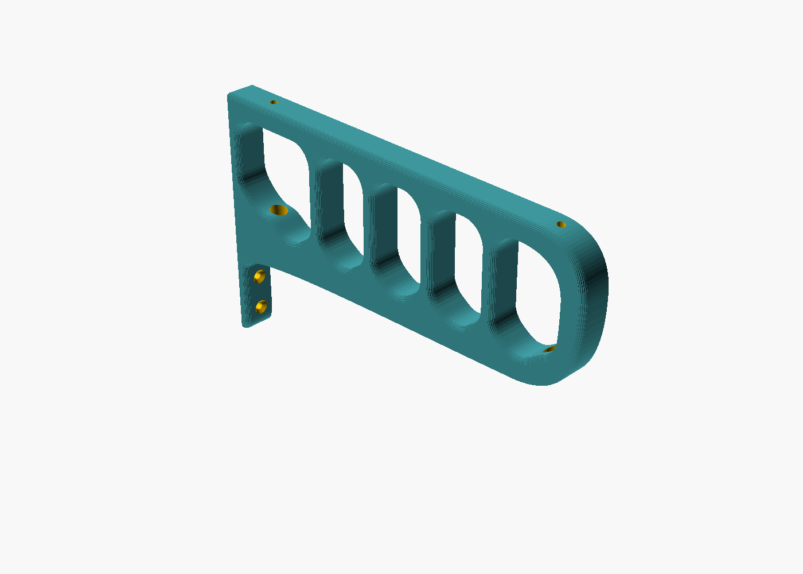

# Support de cintres pour placard (OpenSCAD)

Remplace les deux supports de cintres d'origine, jugés fragiles. Le nouveau support est une **poutre ajourée**, fixée à deux endroits :

* **sous l'étagère du haut**, avec 2 vis à bois posées par en dessous. Rien ne traverse l'étagère, et c'est cette fixation qui porte la charge ;
* **contre le fond du placard**, avec 2 vis à bois (en appui et pour le maintien).

Il compte **5 logements en U**, un par cintre. Le crochet glisse tout seul au point bas de son logement et ne peut pas passer dans le voisin.

| Pièce | Profil |
|---|---|
|  |  |

## Forme

Seules les deux faces d'appui sont planes : le dessus, contre l'étagère, et le dos, contre le fond du placard. Tout le reste est galbé :

* 5 logements identiques, aux angles hauts arrondis et au fond en demi-cercle, séparés par des montants qui relient la barre haute au bras ;
* l'avant descend droit puis s'enroule dans un grand arrondi (R45) vers le dessous ;
* le dessous du bras forme une seule courbe, plus épaisse près du fond, là où l'effort est le plus grand, qui plonge en douceur dans la queue portant les vis du fond ;
* les arêtes sont adoucies : quart de rond sur le dessus à l'impression, chanfrein à 45° côté plateau pour éviter les supports.

Pour régler la forme : `r_galbe` (arrondi avant-bas), `ventre` (galbe sous le bras), `r_haut` (angles hauts des logements), `ep_montant` (largeur des montants) et `r_bord` (arrondi des arêtes).

## Pourquoi une poutre ajourée

Les supports d'origine sont des porte-à-faux : toute la charge fait levier sur deux petites vis plantées dans le fond, qui est souvent un panneau mince. Ici, le bras est relié à la barre haute tous les 40 mm par les montants, et la barre haute est vissée sous l'étagère. Le couple créé par les vestes est donc repris surtout par la vis avant de l'étagère, qui travaille en traction, et par l'appui de la barre haute contre l'étagère.

Les crochets s'accrochent **par le côté**, dans leur logement. Chaque logement offre 33 mm de large et 55 mm de haut au-dessus de son point bas.

Ordre de grandeur pour 5 vestes de 2 kg : environ 15 N·m au niveau du dos, soit à peu près 80 N de traction sur la vis avant. Une vis Ø4 enfoncée de 11 mm dans de l'aggloméré résiste à quelques centaines de newtons à l'arrachement. Avec les montants, toute la pièce travaille comme un seul bloc.

## Encombrement (valeurs par défaut)

* Profondeur de la pièce : **245 mm**.
* Cintres à 48, 88, 128, 168 et 208 mm du fond.
* La pièce reste **55 mm en retrait** du bord avant de l'étagère de **300 mm** : elle ne dépasse jamais.
* La veste la plus en avant dépasse d'environ 60 mm devant son crochet, soit à peu près **268 mm**. Elle reste donc elle aussi sous l'étagère, avec 32 mm de marge, avant même de compter l'espace jusqu'à la porte.
* Hauteur : 130 mm. Largeur : 16 mm.

Le fichier contient des `assert` : si vous changez un paramètre et que la pièce dépasse de l'étagère, ou que la dernière veste risque de toucher la porte, **le rendu s'arrête avec un message**. Si vous connaissez l'espace entre le bord de l'étagère et la porte fermée, indiquez-le dans `ecart_porte` (0 par défaut, par sécurité).

## Paramètres principaux (`support_cintres.scad`)

| Paramètre | Défaut | Rôle |
|---|---|---|
| `profondeur_etagere` | 300 | profondeur de l'étagère du haut |
| `ecart_porte` | 0 | bord de l'étagère → porte fermée (0 si inconnu) |
| `marge_veste` | 60 | épaisseur de veste devant le dernier crochet |
| `longueur` | 245 | profondeur de la pièce |
| `nb_cintres`, `pas` | 5, 40 | nombre de logements et entraxe |
| `ep_montant` | 7 | largeur des montants (logements de `pas - ep_montant` = 33 mm) |
| `haut_crochet` | 45 | hauteur de vos crochets (à mesurer) |
| `largeur` | 16 | largeur de la pièce, qui doit passer dans le crochet |
| `r_galbe`, `ventre`, `r_haut`, `r_bord` | 45, 2, 10, 2,5 | arrondis et galbes |
| `ep_etagere` | 18 | épaisseur de l'étagère (**à mesurer**) |
| `long_vis_etagere` | 16 | longueur des vis de l'étagère |

Avec `apercu = true`, le fichier affiche l'étagère, le fond, la porte (trait rouge, au bord de l'étagère si `ecart_porte = 0`) et les cintres. **N'exportez pas le STL avec cette option active.**

## Impression

* **PETG de préférence, PLA possible.** Sous une charge permanente, le PLA se déforme lentement (fluage), surtout au chaud. Ici, les efforts dans la pièce restent de l'ordre de 1 à 3 MPa, très loin de ce que le PLA supporte. Dans un placard à température ambiante, loin d'un radiateur et du soleil, du PLA devrait donc tenir. Le PETG garde simplement plus de marge.
* Imprimez la pièce **couchée sur le côté**, avec la grande face plate sur le plateau. Les couches suivent alors le cadre, ce qui donne l'orientation la plus solide. Aucun support n'est nécessaire.
* 4 périmètres, 4 à 5 couches dessus et dessous, remplissage gyroïde de 25 % : **environ 125 g** de filament (estimation à ±20 %, votre logiciel de découpe donnera le chiffre exact). Avec 5 périmètres et 40 %, comptez environ 155 g.
* Encombrement à l'impression : 245 × 130 mm sur le plateau, 16 mm de haut. Il faut un plateau d'au moins 250 mm dans un sens (Prusa MK4, Bambu A1/P1/X1, etc.). Sur un plateau de 220 à 235 mm, même en diagonale, ça ne rentre pas : il faut alors réduire `longueur` et `nb_cintres`/`pas`.

## Montage

### Comment on visse sous l'étagère

Les 2 vis de l'étagère sont placées dans les deux parties pleines de la pièce : à l'arrière, entre le dos et le 1er logement (à 19,75 mm du fond), et à l'avant, devant le dernier logement (à 234,75 mm du fond). Leur position est calculée automatiquement. Chaque vis a sa tête noyée dans un lamage Ø9, avec 5 mm de plastique sous la tête. Un **tunnel vertical Ø10** traverse la partie pleine depuis le dessous : on y passe le tournevis par en dessous pour atteindre la vis.

* Avec des vis de 16 mm, il en entre **11 mm dans le bois**. Pour une étagère de 18 mm, il reste donc 7 mm avant de ressortir sur le dessus.
* Si votre étagère est plus fine, indiquez `ep_etagere` : le fichier refuse de générer la pièce si les vis risquent de ressortir.
* Un tournevis de Ø9 maximum passe dans les tunnels : un tournevis cruciforme PH2 classique, ou un embout sur une rallonge fine.
* Il faut une longueur d'au moins 10 cm entre la poignée et la pointe.
* Prenez un embout aimanté, ou bien plantez la vis dans son trou avant de présenter la pièce.

### Matériel

* **Étagère : 2 vis à bois / aggloméré Ø4 × 16 mm**, avec une tête de Ø8 maximum (elle doit passer dans le tunnel Ø10 et se loger dans le lamage Ø9). Une tête cylindrique ou bombée, plate dessous, appuie le mieux. Une tête fraisée convient aussi. Préférez une empreinte **Torx (TX20)** : avec un embout aimanté, la vis tient sur l'embout pendant qu'on la monte dans le tunnel. Calcul de la longueur : 5 mm de plastique + 11 mm dans le bois. Si l'étagère fait moins de 18 mm, prenez-les plus courtes (le fichier vérifie avec `ep_etagere`).
* **Fond : 2 vis à bois Ø4 à tête fraisée**, avec une tête de Ø8 au maximum. Leur longueur vaut 8 mm de plastique plus ce qu'elles doivent entrer dans le fond. Le plus simple : dévissez une vis d'un ancien support et prenez la même longueur, plus 8 mm moins l'épaisseur de la plaque de l'ancien support. Si le fond est un panneau mince (3 mm), une vis de 10 à 12 mm dépasse de 1 à 2 mm derrière : c'est sans conséquence s'il n'y a rien juste derrière.

### Étapes

1. Mettez la pièce en place : plaquez-la contre le fond et sous l'étagère.
2. Pré-percez l'étagère à Ø2,5 sur 10 mm de profondeur, à travers les trous de la pièce. Pour ne pas percer trop loin, mettez un bout de scotch sur le foret comme repère.
3. Vissez les 2 vis de l'étagère par en dessous, à travers les tunnels. Commencez par la vis avant (la plus proche de la porte), c'est celle qui travaille le plus.
4. Vissez les 2 vis du fond, sous le bras. On y accède de face.

Le fond d'une armoire est souvent un panneau mince de 3 mm. Ce n'est pas un problème ici, car il ne sert que d'appui : la charge passe par l'étagère.
