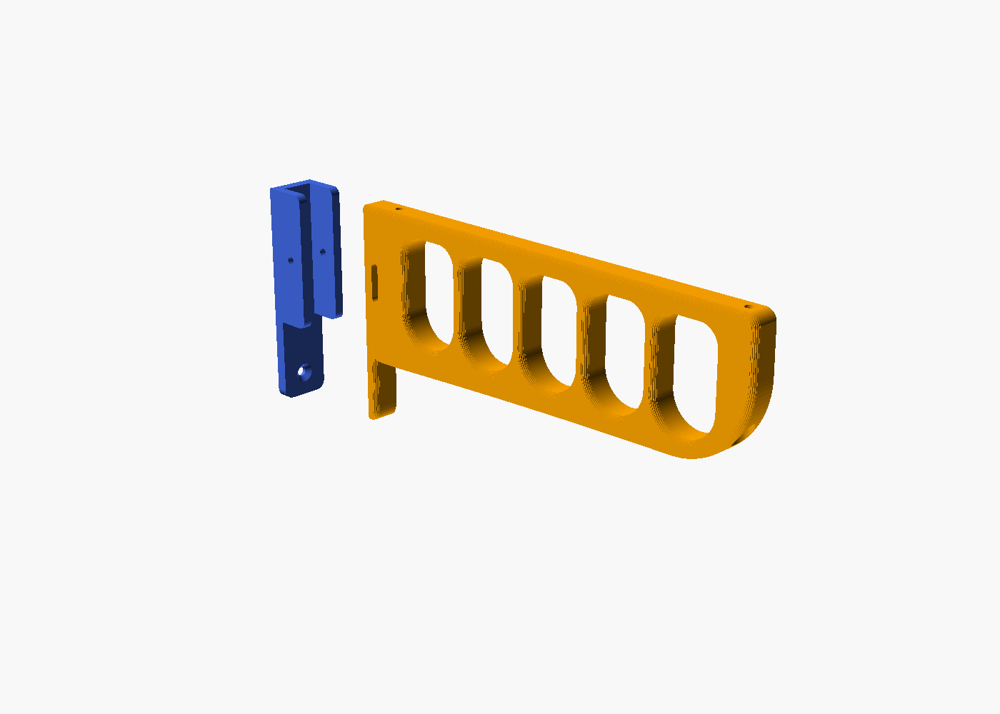
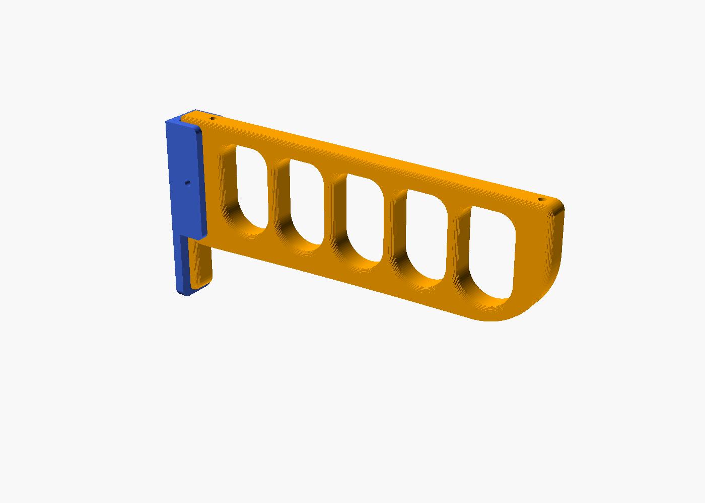
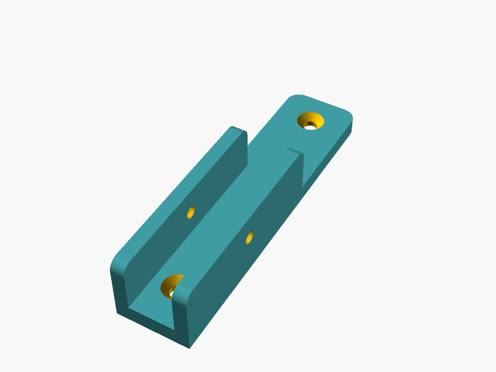
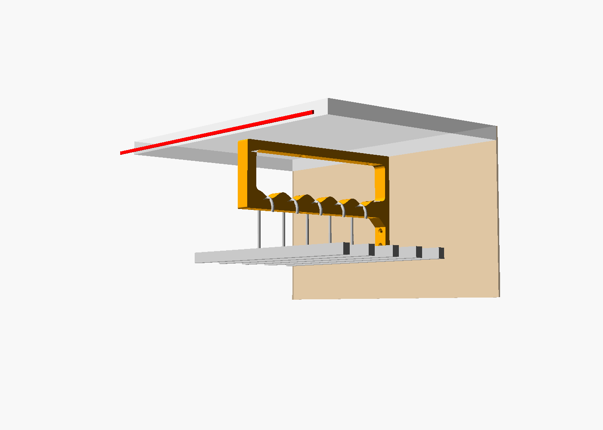
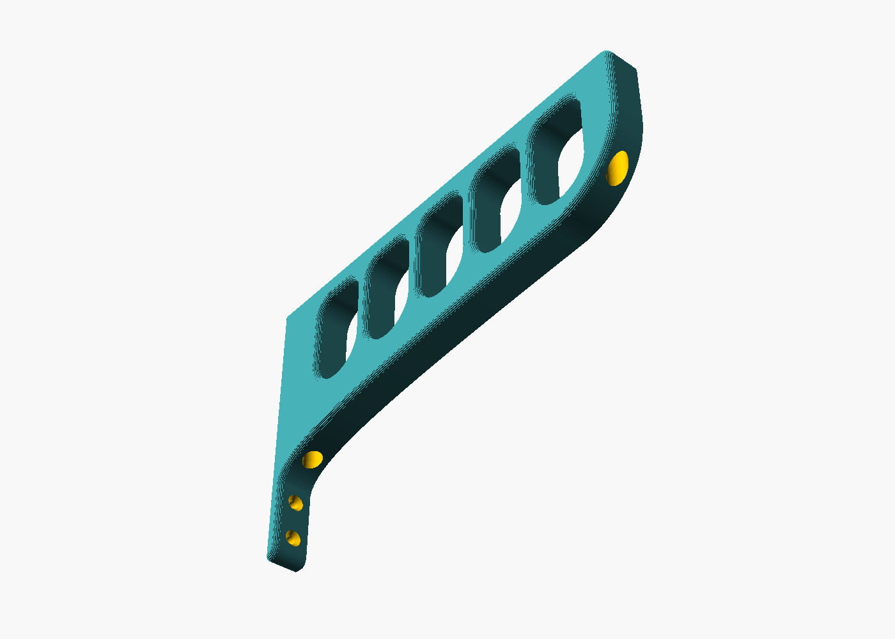

# Support de cintres pour placard (OpenSCAD)

Remplace les deux supports de cintres d'origine, jugés fragiles. Le nouveau support est une **poutre ajourée**, avec 5 logements en U, un par cintre. Le crochet glisse tout seul au point bas de son logement et ne peut pas passer dans le voisin.

Il se compose de **deux pièces**, pour qu'aucune mesure précise ne soit nécessaire :

1. **La platine** (en bleu) se visse seule dans les **deux chevilles déjà présentes au mur** (l'une au-dessus de l'autre, entraxe 90 mm). Comme rien n'est encore devant, les deux vis sont faciles d'accès. Ses deux **joues** forment un couloir vertical, et des creux au dos logent la collerette des chevilles pour qu'elle reste bien à plat contre le mur.
2. **Le support** (en orange) se glisse entre les joues, on le pousse contre l'étagère puis on le visse **sous l'étagère** (2 vis, par en dessous). Un **boulon M4** traverse ensuite les joues et une **fente verticale** du support pour le bloquer.

La fente laisse ±8 mm de jeu en hauteur : c'est l'étagère qui place le support, pas les chevilles.

| Assemblé | Platine (sens d'impression) |
|---|---|
|  |  |

## Comment ça tient

* **L'étagère** porte le poids : la vis avant travaille en traction et empêche l'avant de basculer, la vis arrière tient l'arrière en hauteur.
* **La platine** plaque le support contre le mur et le tient sur les côtés. Les joues serrées par le boulon ajoutent du frottement.
* Le bras est relié à la barre haute tous les 40 mm par les montants, donc toute la poutre travaille comme un seul bloc.

Ordre de grandeur pour 5 vestes de 2 kg : environ 15 N·m, soit à peu près 80 N de traction sur la vis avant de l'étagère. Une vis Ø4 enfoncée de 11 mm dans de l'aggloméré résiste à quelques centaines de newtons à l'arrachement.

Les crochets s'accrochent **par le côté**, dans leur logement : 33 mm de large et 55 mm de haut au-dessus du point bas.

## Forme

Seuls le dessus (contre l'étagère) et le dos (contre la platine) sont plans. Tout le reste est galbé : 5 logements identiques aux angles hauts arrondis et au fond en demi-cercle, un avant qui s'enroule dans un grand arrondi (R45), un dessous du bras en une seule courbe qui plonge dans la queue du dos, et des arêtes adoucies (quart de rond sur le dessus à l'impression, chanfrein à 45° côté plateau).

## Encombrement (valeurs par défaut)

* Platine + support : **251 mm** de profondeur, soit **49 mm en retrait** du bord de l'étagère de 300 mm.
* Cintres à 54, 94, 134, 174 et 214 mm du mur.
* La veste la plus en avant arrive vers **274 mm** : elle reste sous l'étagère.
* Support : 115 mm de haut, 16 mm de large. Platine : 116 × 26,6 mm, 24 mm d'épaisseur avec les joues.

Le fichier contient des `assert` : si un réglage fait dépasser la pièce de l'étagère, toucher la porte par la dernière veste, ressortir une vis sur le dessus de l'étagère ou se chevaucher deux perçages, **le rendu s'arrête avec un message**.

## Paramètres principaux (`support_cintres.scad`)

| Paramètre | Défaut | Rôle |
|---|---|---|
| `z_cheville_haute` | 17 | distance entre le dessous de l'étagère et le centre de la cheville du haut |
| `entraxe_chevilles` | 90 | écart vertical entre les deux chevilles (**à vérifier au mètre**) |
| `d_vis_cheville`, `d_tete_cheville` | 5, 10 | passage et tête fraisée des vis des chevilles |
| `d_collerette`, `p_collerette` | 11, 1,5 | creux au dos de la platine pour la collerette des chevilles |
| `reglage` | 8 | jeu en hauteur permis par la fente (±) |
| `jeu_joue` | 0,3 | jeu entre le support et chaque joue |
| `ep_etagere` | 18 | épaisseur de l'étagère (**à mesurer**) |
| `long_vis_etagere` | 16 | longueur des vis de l'étagère |
| `profondeur_etagere` | 300 | profondeur de l'étagère du haut |
| `ecart_porte` | 0 | bord de l'étagère → porte fermée (0 si inconnu) |
| `nb_cintres`, `pas` | 5, 40 | nombre de logements et entraxe |
| `haut_crochet` | 45 | hauteur de vos crochets |
| `largeur` | 16 | largeur du support, qui doit passer dans le crochet |
| `piece` | `"support"` | pièce exportée : `"support"` ou `"platine"` |

Avec `apercu = true`, le fichier affiche l'étagère, le mur, la porte (trait rouge), les deux pièces et les cintres. **N'exportez pas le STL avec cette option active.**

## Impression

Deux fichiers sont fournis : `support_cintres.stl` et `platine.stl`. Si vous changez un réglage, exportez chaque pièce avec `piece = "support"` puis `piece = "platine"`.

* **PETG de préférence, PLA possible.** Sous une charge permanente, le PLA se déforme lentement (fluage), surtout au chaud. Ici, les efforts restent modérés : dans un placard à température ambiante, loin d'un radiateur et du soleil, du PLA devrait tenir. Le PETG garde simplement plus de marge.
* **Support :** couché sur le côté, la grande face plate sur le plateau (245 × 115 mm, 16 mm de haut). Il faut un plateau d'au moins 250 mm dans un sens (Bambu P1S/A1/X1, Prusa MK4, etc.).
* **Platine :** le STL est déjà posé sur son dos (la face contre le mur sur le plateau), joues vers le haut. Les creux des chevilles sont sur le plateau : ce sont de petits ponts de 11 mm, sans support.
* Aucun support d'impression pour l'une ou l'autre.
* 4 périmètres, 4 à 5 couches dessus et dessous, remplissage gyroïde de 25 % : **environ 110 g** pour le support et **27 g** pour la platine. Ces chiffres viennent d'une découpe d'essai dans PrusaSlicer, en PETG ; Bambu Studio donnera un résultat proche. Avec 5 périmètres et 40 %, comptez environ 130 g pour le support.
* Le support doit glisser entre les joues avec 0,3 mm de jeu de chaque côté. Si c'est trop serré (ou trop lâche), ajustez `jeu_joue` et réimprimez la platine seulement.

## Montage

### Matériel

* **Chevilles (2 vis identiques) :** adaptées à vos chevilles, Ø5 maximum, **tête fraisée Ø10 maximum**. Longueur = 6 mm de platine + la profondeur de la cheville, par exemple 5 × 35 pour une cheville de 30 mm.
* **Étagère (2 vis) : vis à bois / aggloméré Ø4 × 16 mm**, tête de Ø8 maximum, de préférence à empreinte **Torx (TX20)** avec un embout aimanté. 5 mm de plastique + 11 mm dans le bois : si l'étagère fait moins de 18 mm, prenez-les plus courtes (le fichier vérifie avec `ep_etagere`).
* **Blocage : 1 boulon M4 × 30** (tête cylindrique ou bombée) **+ 1 écrou M4**. L'écrou se loge dans le creux hexagonal de la joue droite, vue de face.

### Étapes

1. **Platine :** vissez-la dans les deux chevilles, joues vers vous.
2. **Support :** glissez-le entre les joues, dos contre la platine, et poussez-le vers le haut jusqu'à ce qu'il touche l'étagère.
3. **Étagère :** pré-percez à Ø2,5 sur 10 mm à travers les deux trous de la barre haute, en passant par les tunnels (un bout de scotch sur le foret sert de repère). Vissez les 2 vis par en dessous, à travers les tunnels. Commencez par la vis avant.
4. **Blocage :** mettez l'écrou dans son creux, passez le boulon à travers la joue gauche, la fente du support et la joue droite, puis serrez.

### Les vis de l'étagère

Elles se trouvent dans les deux parties pleines du support : à l'arrière, entre le dos et le 1er logement, et à l'avant, devant le dernier logement. Chaque tête est noyée dans un lamage Ø9, avec 5 mm de plastique dessous. Un **tunnel vertical Ø10** traverse la partie pleine depuis le dessous : on y passe le tournevis (Ø9 maximum, au moins 10 cm de long).

