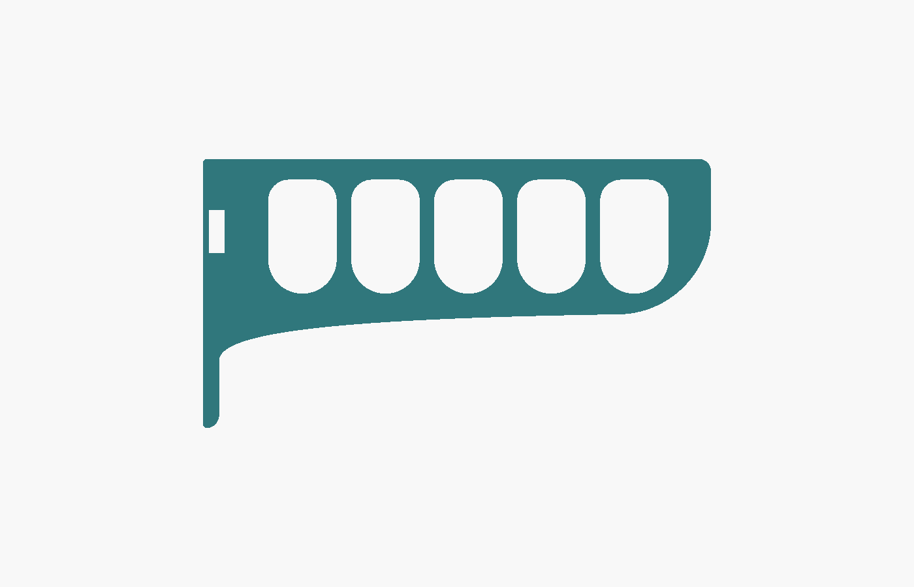
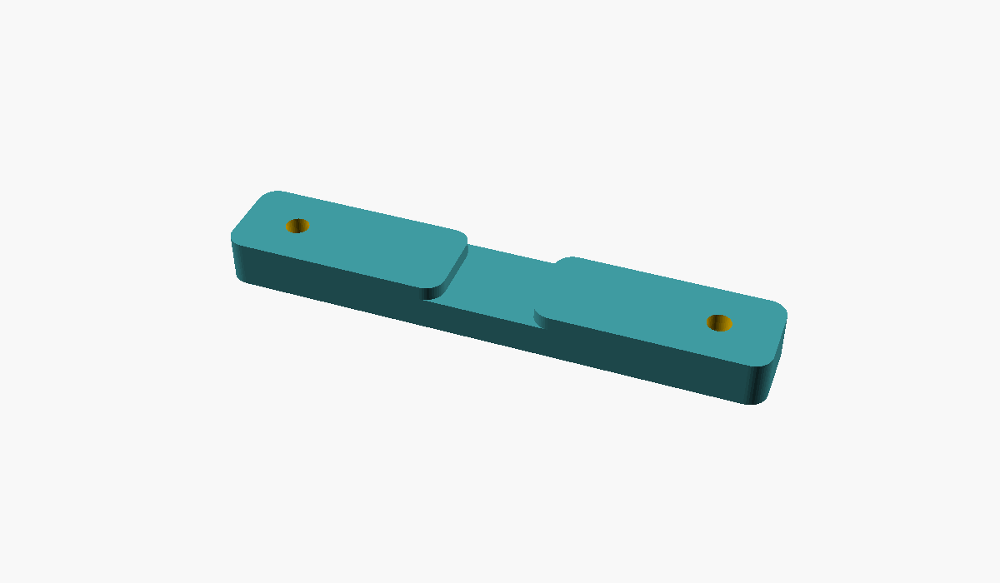

# Support de cintres pour placard (OpenSCAD)

Remplace les deux supports de cintres d'origine, jugés fragiles. Le nouveau support est une **poutre ajourée** en deux pièces imprimées :

* le **support**, avec 5 logements en U, un par cintre. Le crochet glisse tout seul au point bas de son logement et ne peut pas passer dans le voisin ;
* une petite **traverse**, vissée dans les **deux chevilles déjà présentes au mur** (côte à côte, entraxe 90 mm). Elle passe dans une fente du support et le plaque contre le mur.

À l'avant, **une seule vis** fixe le support sous l'étagère, posée par en dessous. Rien ne traverse l'étagère.

| Assemblage | Profil |
|---|---|
|  |  |

## Forme

Seules les deux faces d'appui sont planes : le dessus, contre l'étagère, et le dos, contre le mur. Tout le reste est galbé :

* 5 logements identiques, aux angles hauts arrondis et au fond en demi-cercle, séparés par des montants qui relient la barre haute au bras ;
* l'avant descend droit puis s'enroule dans un grand arrondi (R45) vers le dessous ;
* le dessous du bras forme une seule courbe, plus épaisse près du mur, là où l'effort est le plus grand, qui plonge en douceur dans une queue en appui contre le mur ;
* les arêtes sont adoucies : quart de rond sur le dessus à l'impression, chanfrein à 45° côté plateau pour éviter les supports.

Pour régler la forme : `r_galbe` (arrondi avant-bas), `ventre` (galbe sous le bras), `r_haut` (angles hauts des logements), `ep_montant` (largeur des montants) et `r_bord` (arrondi des arêtes).

## Comment ça tient

Les supports d'origine sont des porte-à-faux : toute la charge fait levier sur deux petites vis. Ici :

* **à l'arrière**, la traverse est vissée dans les chevilles du mur. Elle tient le support en hauteur et sur les côtés, et le plaque contre le mur ;
* **à l'avant**, la vis de l'étagère travaille en traction. C'est elle qui empêche l'avant de basculer vers le bas ;
* le **bas de la queue** appuie contre le mur, ce qui complète le couple ;
* le bras est relié à la barre haute tous les 40 mm par les montants, donc toute la pièce travaille comme un seul bloc.

Ordre de grandeur pour 5 vestes de 2 kg : environ 15 N·m au niveau du mur, soit à peu près 80 N de traction sur la vis avant. Une vis Ø4 enfoncée de 11 mm dans de l'aggloméré résiste à quelques centaines de newtons à l'arrachement.

Les crochets s'accrochent **par le côté**, dans leur logement. Chaque logement offre 33 mm de large et 55 mm de haut au-dessus de son point bas.

## Encombrement (valeurs par défaut)

* Profondeur du support : **245 mm**. Il reste **55 mm en retrait** du bord avant de l'étagère de **300 mm** : il ne dépasse jamais.
* Cintres à 48, 88, 128, 168 et 208 mm du mur.
* La veste la plus en avant dépasse d'environ 60 mm devant son crochet, soit à peu près **268 mm**. Elle reste elle aussi sous l'étagère, avant même de compter l'espace jusqu'à la porte.
* Support : 130 mm de haut, 16 mm de large. Traverse : 114 × 20 × 10 mm.

Le fichier contient des `assert` : si un réglage fait dépasser la pièce de l'étagère, toucher la porte par la dernière veste, ressortir la vis sur le dessus de l'étagère ou se chevaucher la traverse et le support, **le rendu s'arrête avec un message**.

## Paramètres principaux (`support_cintres.scad`)

| Paramètre | Défaut | Rôle |
|---|---|---|
| `z_chevilles` | 35 | distance entre le dessous de l'étagère et l'axe des chevilles (**à mesurer**) |
| `entraxe_chevilles` | 90 | écart entre les deux chevilles |
| `d_vis_cheville`, `d_tete_cheville` | 5, 10 | passage et tête fraisée des vis des chevilles |
| `profondeur_etagere` | 300 | profondeur de l'étagère du haut |
| `ecart_porte` | 0 | bord de l'étagère → porte fermée (0 si inconnu) |
| `marge_veste` | 60 | épaisseur de veste devant le dernier crochet |
| `longueur` | 245 | profondeur du support |
| `nb_cintres`, `pas` | 5, 40 | nombre de logements et entraxe |
| `ep_montant` | 7 | largeur des montants (logements de `pas - ep_montant` = 33 mm) |
| `haut_crochet` | 45 | hauteur de vos crochets (à mesurer) |
| `largeur` | 16 | largeur du support, qui doit passer dans le crochet |
| `r_galbe`, `ventre`, `r_haut`, `r_bord` | 45, 2, 10, 2,5 | arrondis et galbes |
| `ep_etagere` | 18 | épaisseur de l'étagère (**à mesurer**) |
| `long_vis_etagere` | 16 | longueur de la vis de l'étagère |
| `piece` | `"support"` | pièce exportée : `"support"` ou `"traverse"` |

Avec `apercu = true`, le fichier affiche l'étagère, le mur, la porte (trait rouge, au bord de l'étagère si `ecart_porte = 0`), la traverse et les cintres. **N'exportez pas le STL avec cette option active.**

## Impression

Deux fichiers sont fournis : `support_cintres.stl` et `traverse.stl`. Si vous changez un réglage, exportez le support avec `piece = "support"` et la traverse avec `piece = "traverse"`.

* **PETG de préférence, PLA possible.** Sous une charge permanente, le PLA se déforme lentement (fluage), surtout au chaud. Ici, les efforts dans la pièce restent de l'ordre de 1 à 3 MPa, très loin de ce que le PLA supporte. Dans un placard à température ambiante, loin d'un radiateur et du soleil, du PLA devrait donc tenir. Le PETG garde simplement plus de marge.
* **Support :** imprimez-le **couché sur le côté**, avec la grande face plate sur le plateau. Les couches suivent alors le cadre, ce qui donne l'orientation la plus solide. Aucun support d'impression n'est nécessaire. Encombrement : 245 × 130 mm sur le plateau, 16 mm de haut. Il faut un plateau d'au moins 250 mm dans un sens (Bambu P1S/A1/X1, Prusa MK4, etc.).
* **Traverse :** le STL est déjà posé à plat, face avant sur le plateau. Aucun support d'impression n'est nécessaire.
* 4 périmètres, 4 à 5 couches dessus et dessous, remplissage gyroïde de 25 % : **environ 125 g** pour le support et **environ 20 g** pour la traverse (estimation à ±20 %, votre logiciel de découpe donnera le chiffre exact).

## Montage

### Matériel

* **Chevilles (2 vis) :** des vis adaptées à vos chevilles, à **tête fraisée de Ø10 maximum**. Leur longueur vaut 10 mm de traverse plus la profondeur de la cheville : par exemple 4 × 40 ou 5 × 40 pour des chevilles de 30 mm. Le plus simple est de reprendre les vis d'origine et d'ajouter 10 mm. Si vos vis font plus de 5 mm de diamètre, réglez `d_vis_cheville`.
* **Étagère (1 vis) : vis à bois / aggloméré Ø4 × 16 mm**, avec une tête de Ø8 maximum (elle doit passer dans le tunnel Ø10 et se loger dans le lamage Ø9). Une tête cylindrique ou bombée, plate dessous, appuie le mieux. Une tête fraisée convient aussi. Préférez une empreinte **Torx (TX20)** : avec un embout aimanté, la vis tient sur l'embout pendant qu'on la monte dans le tunnel. Calcul de la longueur : 5 mm de plastique + 11 mm dans le bois. Si l'étagère fait moins de 18 mm, prenez une vis plus courte (le fichier vérifie avec `ep_etagere`).

### Avant d'imprimer

Mesurez **la distance entre le dessous de l'étagère et le centre des chevilles**, et indiquez-la dans `z_chevilles`. La fente du support est placée à cette hauteur. Si les chevilles sont sous le bras, la queue du support s'allonge et s'épaissit automatiquement autour de la fente.

### Étapes

1. Glissez la traverse dans la fente du support, côté mur, et centrez-la.
2. Présentez l'ensemble : support plaqué contre le mur et sous l'étagère, vis de la traverse en face des chevilles.
3. Vissez les 2 vis de la traverse dans les chevilles. On y accède de face, de chaque côté du support.
4. Pré-percez l'étagère à Ø2,5 sur 10 mm de profondeur, à travers le trou de la barre haute, en passant par le tunnel. Pour ne pas percer trop loin, mettez un bout de scotch sur le foret comme repère.
5. Vissez la vis de l'étagère par en dessous, à travers le tunnel.

### La vis de l'étagère

Elle est placée dans la partie pleine à l'avant, devant le dernier logement (à 234,75 mm du mur). Sa tête est noyée dans un lamage Ø9, avec 5 mm de plastique sous la tête. Un **tunnel vertical Ø10** traverse la partie pleine depuis le dessous : on y passe le tournevis par en dessous pour atteindre la vis.

* Il faut un tournevis de Ø9 maximum, avec au moins 10 cm entre la poignée et la pointe : un tournevis Torx ou cruciforme classique, ou un embout sur une rallonge fine.
* Prenez un embout aimanté, ou plantez la vis dans son trou avant de présenter la pièce.

